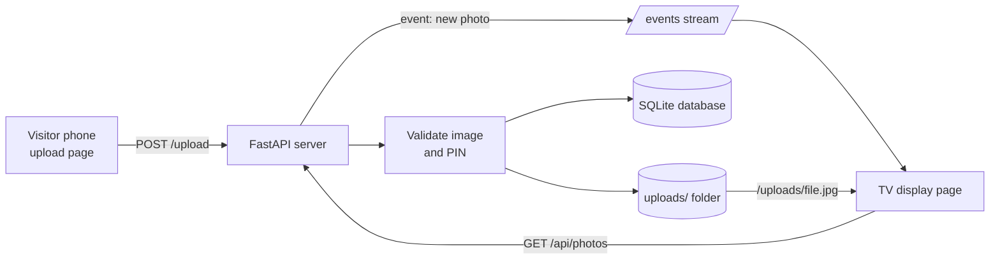
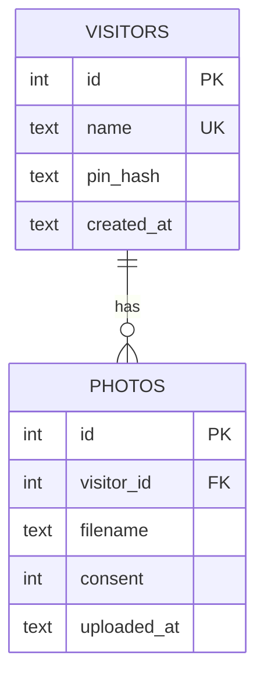

# Architecture

## Stack and reasons
| Choice | Why |
|---|---|
| FastAPI | Simple, fast, async (good for live updates), automatic validation |
| SQLite | No setup, one file, enough for one event |
| Pillow | Checks that a file is a real image, resizes, strips EXIF/GPS |
| Server-Sent Events | The TV only needs updates from server to screen, simpler than WebSockets |
| Plain HTML/JS | Only two pages, no build step, easy to explain |

## Diagram

## Data model

## Key design decisions
- **Returning visitor:** name + 4-digit PIN. PIN is salted and hashed (PBKDF2).
- **Privacy:** consent checkbox required, consent stored per photo, GPS data removed by re-saving as JPEG, delete-my-photos, 30-day auto-delete.
- **File validation:** real content check with Pillow, random filenames, 5 MB and 5-file limits.
- **Concurrent uploads:** each request has its own database connection; files get unique random names, so simultaneous uploads do not clash. Slides play in upload order.

## Known limitations
- Rate limiting is in memory: resets on restart, works for one server only.
- Auto-delete does not notify the display; it refreshes within 60 seconds.
- A 4-digit PIN is weak by design; rate limiting reduces the risk.
- SQLite suits one event, not heavy traffic.